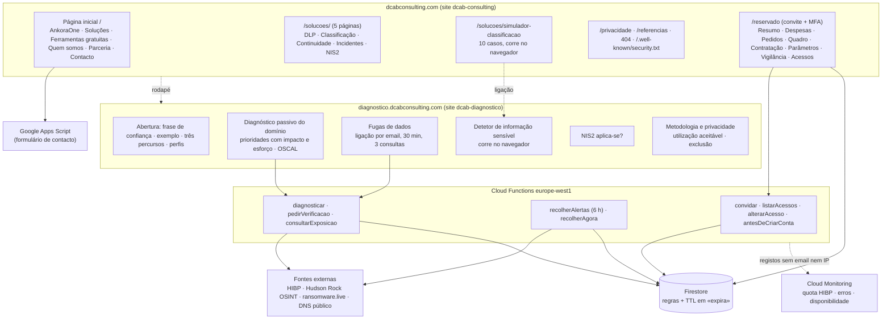

# DCAB Consulting — registo da versão 1.1 (17-10-2026)

Documento de referência da versão publicada do site, da área reservada, da vigilância de exposição e do Observatório. Serve de base para avaliar melhorias futuras: cada secção termina com o que fica por fazer, e a última secção junta tudo numa lista de prioridades.

| Campo | Valor |
|---|---|
| Versão | 1.1 (sucede à 1.0, de 16-10-2026) |
| Data | 17-10-2026 |
| Estado | Publicada e validada a 18-10-2026 |
| Origem | Parecer externo sobre experiência, conversão e riscos reputacionais do Observatório |
| Projeto Firebase | `dcab-consulting` (plano Blaze, região `europe-west1`) |
| Sites de alojamento | `dcab-consulting` → dcabconsulting.com · `dcab-diagnostico` → diagnostico.dcabconsulting.com |
| Pacotes | `site-dcabconsulting-completo.zip` · `observatorio-dcab.zip` |
| Pastas no Mac | `~/Documents/site-dcabconsulting` · `~/Documents/diagnostico-dcab` |
| Documento de processo | «Vigilância de exposição digital — fluxo de trabalho e implementação», v1.1 (por aprovar) |

## 1. Mapa da versão

## 2. Componentes

### 2.1 Site público (dcabconsulting.com)
- Páginas geradas por `ferramentas/gerar_inicio.py`, `gerar_solucoes.py` e `gerar_simulador.py`, a partir das peças comuns de `ferramentas/comum.py` (cabeçalho, menu e rodapé). A política de privacidade e a 404 são estáticas; `atualizar_legais.py` aplica-lhes o menu e o rodapé.
- Formulário de contacto: `public/assets/js/principal.js`, que envia para o Google Apps Script. O endereço de destino fica nas propriedades do Apps Script e nunca aparece no site. **O `principal.js` não vem nos pacotes e não pode ser substituído.**
- Vídeo da abertura: entrada de 4,75 s seguida de um ciclo de 2,8 s (WebM VP9 e MP4 H.264, 1280×720, menos de 350 KB cada, MP4 com `moov` no início). Com «movimento reduzido» ou «poupança de dados» ativos, mostra só a imagem final. Tem um botão «Parar animação», e a escolha fica guardada no navegador.
- Ferramentas gratuitas: diagnóstico do domínio, detetor e simulador, ligados a partir da página inicial, do rodapé e das páginas de Classificação e de DLP.
- **Referências e versão** (`/referencias`, gerada por `gerar_referencias.py`): diplomas, normas, versões das ferramentas e registo de alterações. Atualizar a cada versão e, no mínimo, de seis em seis meses.
- Formulário de contacto com dois assuntos novos («Diagnóstico completo e plano de correção» e «Exclusão de domínio do Observatório»), pré-selecionados por `?assunto=plano` ou `?assunto=exclusao` (`assunto.js`). O `Codigo.gs` do Apps Script tem de ter os mesmos assuntos.

### 2.2 Área reservada (/reservado)
- Acesso só por convite (`antesDeCriarConta` bloqueia contas sem convite), com email verificado e segundo fator TOTP obrigatório.
- Papéis:
  - `admin`;
  - `editor`;
  - `leitor`;
  - `cliente`, que só vê o separador Vigilância dos seus clientes.
- Separadores: Resumo, Despesas, Pedidos de pagamento, Quadro de investimento, Contratação, Parâmetros, Vigilância e Acessos (este só para administradores).
- Cabeçalhos `noindex` e `no-store`, CSP própria e bibliotecas servidas pelo próprio site (pdf.js, SheetJS, qrcodejs, jsQR).

### 2.3 Vigilância de exposição
- Fontes:
  - Hudson Rock OSINT, sem chave: totais de infostealers por domínio;
  - ransomware.live, sem chave: vítimas publicadas;
  - HIBP v3 com a chave `HIBP_API_KEY`: fugas do domínio verificado.
- `recolherAlertas` corre de 6 em 6 horas (Europe/Lisbon) e `recolherAgora` corre a pedido de um administrador.
- Coleções: `clientes/{id}` e `interno/config` (esta só para a equipa), `alertas`, `alertas_fonte` (só equipa) e `historico`, com TTL de 1095 dias.
- Nunca guarda palavras-passe, cookies, IPs nem ficheiros. As identidades ficam mascaradas.

### 2.4 Observatório (diagnostico.dcabconsulting.com)
- **Abertura.** Frase de confiança, cartão de exemplo gerado a partir de `exemplo.js`, três percursos (domínio, email, documento) e uma linha por perfil (administração, CISO, DPO, conformidade).
- **Diagnóstico passivo.** Analisa o email (MX, SPF, DMARC, DKIM, MTA-STS, TLS-RPT e BIMI), o DNS (DNSSEC, CAA) e o site (TLS, HSTS, CSP, cabeçalhos, cookies, security.txt).
  - Os resultados ligam-se ao DL 125/2025, à 2.ª versão do QNRCS, ao Reg. 756/2026 e ao RGPD, e exportam-se em OSCAL 1.2.0.
  - Recusa endereços privados, fixa o IP depois da resolução DNS e só segue redirecionamentos dentro do mesmo domínio.
  - O resultado abre com o aviso de fotografia pública (também na impressão e no OSCAL) e com as três correções que mais reduzem o risco. Cada falha mostra impacto, esforço típico e quem costuma corrigir (`ACOES` em `motor/catalogo.js`, valores indicativos).
  - A comparação com o diagnóstico completo e o botão «Receber plano de correção priorizado» levam ao formulário com o assunto já escolhido.
- **Fugas de dados.**
  - O endereço só é pesquisado com consentimento expresso (RGPD, art. 49.º, n.º 1, al. a)).
  - A ligação chega por email e vale 30 minutos, até 3 consultas. O token vai depois do «#» e é enviado por POST.
  - O relatório do domínio completo só é mostrado aos contactos em `observatorio_dominios/<d>.contactos`.
- **Detetor de informação sensível.**
  - O que procura:
    - NIF, NISS, Cartão de Cidadão, IBAN e cartões de pagamento, com dígito de controlo;
    - emails, telefones e datas de nascimento;
    - categorias especiais do RGPD (arts. 9.º e 10.º);
    - remunerações e credenciais;
    - sinais de informação privilegiada (Reg. (UE) 596/2014) e de sigilo;
    - marcas de classificação.
  - Nos ficheiros Office também avisa sobre metadados, comentários, alterações registadas, folhas ocultas e etiquetas do Microsoft Purview.
  - Corre só no navegador. Mostra os pedidos de rede registados durante a análise (zero) e a impressão digital SHA-256 dos dois ficheiros; o navegador confirma-a pelo atributo `integrity`. `ferramentas/atualizar-hashes.js` atualiza os valores em cada publicação.
- **NIS2 aplica-se?** Quatro perguntas com base nos arts. 3.º, 6.º e 7.º do DL 125/2025.
- **Metodologia e privacidade.** O que é guardado e durante quanto tempo, utilização aceitável (sem alegações sobre terceiros, sem automatização) e pedido de exclusão.

### 2.5 Documentos internos (não publicados)
- `mapa-correspondencias-dl125-qnrcs.xlsx`: mapa DL 125/2025, Reg. 756/2026 e QNRCS, com 22 folhas.
- `oscal-nacional-dl125-reg756.zip`: catálogo com 349 controlos e 5 perfis (Básico, Substancial, Elevado, Grupo B, Grupo A), para importar na AnkoraOne.

## 3. Dados e conservação

| Coleção | Conteúdo | Conservação (TTL em `expira`) |
|---|---|---|
| `observatorio_limites` | contadores de limites (HMAC, sem IP) | 2 h (por hora) · 26 h (por dia) |
| `observatorio_sal` | sal aleatório diário do HMAC | 2 dias |
| `observatorio_cache` | resultado por domínio | 6 h (até à 1.0 ficava 7 dias por erro; corrigido) |
| `observatorio_resumos` | resumo do resultado de cada domínio | 12 meses |
| `observatorio_verificacoes` | endereço e token (hash) da ligação de fugas | 30 min |
| `observatorio_consultas` | auditoria: domínio, data, sem endereço | 90 dias |
| `observatorio_dominios` · `observatorio_exclusoes` | contactos autorizados · domínios excluídos | manual |
| `clientes/*/alertas` · `alertas_fonte` · `historico` | alertas da vigilância | 1095 dias |
| `acessos` · `auditoria` · `projetos` | área reservada | manual |

São 9 políticas de TTL. O Firestore apaga os documentos normalmente nas 24 horas seguintes ao fim do prazo; os textos públicos dizem isso.

Registos técnicos (Cloud Logging): 90 dias, sem emails nem IPs nas mensagens (`registarErro`) e sem os registos de pedidos do Cloud Run (exclusão `pedidos-sem-ip`, criada por `monitorizacao.sh`).

## 4. Segurança

Controlos em vigor:
- **Cabeçalhos:**
  - HSTS com preload, `nosniff`, Referrer-Policy e COOP;
  - CSP sem scripts nem estilos inline em todas as páginas públicas; a 404 tem CSP em `meta`;
  - `X-Frame-Options: DENY` nas páginas públicas.
- **Cache:** HTML, JS e CSS são sempre revalidados (`no-cache`). Só imagens, vídeo e tipos de letra têm cache de 24 horas. A área reservada usa `no-store`.
- **Firestore:** nega tudo o que não está previsto.
  - Nos alertas só podem mudar estado, avaliação, responsável e notas, com valores fechados.
  - O histórico só se cria para alertas que existem, com estado válido.
- **Funções chamáveis:** administrador ativo, email verificado e TOTP.
- **Observatório:**
  - limites por origem (os dois últimos valores do `X-Forwarded-For`), por caixa (3 por hora, 5 por dia), por domínio (20 por dia) e global (200 por hora, 1500 por dia);
  - o IP é guardado só como HMAC com sal diário;
  - motor só de leitura, com proteção contra SSRF e DNS rebinding.
- **Detetor:** pesquisas de custo linear (2 milhões de caracteres em menos de 1 s), limite real de descompactação de 60 MB, entradas danificadas recusadas e todo o texto escapado antes de entrar no HTML.
- **security.txt** nos dois sites, válido até 15-10-2027.
- **Integridade do detetor:** atributo `integrity` (SHA-256) nas duas etiquetas `<script>`, verificado pelo navegador; `publicar.sh` compara o ficheiro publicado com o local.
- **Monitorização** (`monitorizacao.sh`): alertas de quota da HIBP (`hibp_429`), erros das funções e disponibilidade do site, de /reservado e do Observatório.

## 5. O que mudou na versão 1.1

| Ponto do parecer | O que foi feito |
|---|---|
| Três percursos claros | Cartões «Analisar o meu domínio», «Verificar o meu email» e «Analisar um documento» logo abaixo da abertura |
| Exemplo visível | Cartão de resultado fictício na abertura, gerado a partir dos dados do exemplo |
| Benefício por perfil | Uma linha para administração, CISO, DPO e conformidade |
| Menos texto legal à entrada | Texto da abertura reduzido à frase de confiança; enquadramento legal num bloco que abre a pedido; secção «Metodologia e privacidade» no fim |
| CTA específico | «Receber plano de correção priorizado», com o assunto pré-selecionado no formulário |
| O que o completo acrescenta | Tabela de comparação no fim do resultado |
| Resultado mau sem saber o que fazer | Três correções prioritárias; impacto, esforço e responsável em cada falha |
| Uso indevido sobre terceiros | Aviso de fotografia pública com data e hora no resultado, na impressão e no OSCAL; utilização aceitável; pedido de exclusão |
| Desconfiança no detetor | Indicador de processamento local, contagem de pedidos, instruções de verificação, SHA-256 e `integrity` |
| Política de dados | Tabela de serviços externos, registos técnicos e tabela do que o Observatório guarda |
| Monitorização | `monitorizacao.sh` e `GUIA-MONITORIZACAO.md` |
| Matriz versionada | Página «Referências e versão» |
| Frase de topo | Adotada com correção: «Os documentos que analisa não saem do seu computador» |

Correções da revisão independente desta versão: prazo da cache (7 dias → 6 horas), resultados antigos em cache descartados, prazos de apagamento descritos com a margem do TTL, HMAC também do email descrito, verificação de /reservado sem redirecionamento, métrica de erros sem contagem dupla, retenção dos registos fixada pelo script (90 dias), impressão do enquadramento legal, «registrar» substituído.

## 5-A. Verificação legal e revisão de texto (17-10-2026)

Regra de trabalho: tudo o que se publica é confirmado na fonte oficial, e todo o texto é revisto em português de Portugal, sem chavões.

**Fontes usadas:** PDF oficiais do DL 125/2025 (DR 1.ª série, n.º 234, 04-12-2025), do Regulamento n.º 756/2026 (DR 2.ª série, n.º 118, 22-06-2026), da Lei 109/2009 e da Taxonomia RNCSIRT v3.3; EUR-Lex (RGPD, NIS2, CER, MAR, Decisão 2011/61/UE); política de privacidade do Have I Been Pwned.

| Correção | Fundamento |
|---|---|
| Operador do HIBP: Superlative Enterprises Pty Ltd (Austrália), dados nos EUA (Microsoft Azure) | haveibeenpwned.com/Privacy |
| Informação sobre os riscos da transferência antes do consentimento, no formulário e na política | RGPD, art. 49.º, n.º 1, al. a) |
| Fundamento de cada tratamento, direito de oposição, decisões automatizadas, campos obrigatórios, contacto para direitos, ausência de EPD | RGPD, arts. 6.º, 13.º, 21.º, 22.º |
| Área reservada e armazenamento no navegador descritos | RGPD, art. 13.º; Lei n.º 41/2004, art. 5.º, n.º 2 |
| Transferências da Google: Quadro de Privacidade de Dados UE-EUA e cláusulas contratuais-tipo | Decisão de Execução (UE) 2023/1795 |
| Registos técnicos: 90 dias (era 365) | RGPD, art. 5.º, n.º 1, als. c) e e) |
| Autoidentificação: prazo de 60 dias após a plataforma (23-06-2026) já decorrido; incumprimento é contraordenação grave | DL 125/2025, arts. 8.º, n.º 1, e 62.º, n.º 1, al. a); CNCS (contagem em dias úteis, fonte secundária) |
| Regime transitório: contraordenações das als. b), c) e f) do art. 61.º, n.º 1, a partir de 22-06-2028 | Decreto preambular, art. 10.º, n.º 2 |
| Entrada em vigor descrita como «120 dias após a publicação, no início de abril de 2026»; dispensa de coimas durante 12 meses | Decreto preambular, art. 11.º; art. 65.º |
| Responsabilidade dos titulares só por dolo ou culpa grave | Art. 25.º, n.º 2 |
| Banco de Portugal, CMVM e ASF fora do âmbito | Art. 3.º, n.º 3, al. f) |
| Níveis cumulativos e declaração de aplicabilidade | Regulamento, arts. 30.º, n.os 2 e 3, e 27.º, n.º 5 |
| Art. 8.º-A da Lei do Cibercrime como condição de não punibilidade (comunicação ao proprietário e ao CNCS) | Lei 109/2009, art. 8.º-A, n.os 1, al. c), e 2 |
| T.AM só no Grupo A; ID.AR-7 também no Básico | Regulamento, Anexos III e IV |

**Por confirmar fora do código:** data exata de entrada em vigor no registo consolidado do DRE; data de disponibilização da MyCiber no site do CNCS; se a lista da CNPD de tratamentos sujeitos a avaliação de impacto abrange a vigilância de exposição.

**Pendente de decisão (governação):** contrato de subcontratação (art. 28.º, n.º 3) e avaliação de impacto (art. 35.º) para a vigilância; nota de informação aos trabalhadores dos clientes (art. 14.º); alternativa ao art. 49.º para a consulta de fugas, se o volume crescer (cláusulas contratuais-tipo com o operador do HIBP ou encaminhar o titular para o próprio serviço).

**Texto:** segunda revisão integral em PT-PT. Uniformizados «endereço de email», «autenticação multifator» e «Utilização aceitável»; frases longas divididas; voz passiva desnecessária retirada; «registrar» substituído.

## 6. O que mudou na versão 1.0 (16-10-2026)

### Segurança e arquitetura
1. **Crítico, corrigido.** No Node 22, o motor do Observatório não conseguia fazer pedidos HTTP(S). A função `lookup` só devolvia um endereço, e por isso havia resultados falsos sobre redirecionamento HTTP→HTTPS, security.txt e MTA-STS.
   - Correção: `lookupFixo` em `motor/rede.js`, com o teste `test/rede.test.js` contra um servidor local.
2. Limites do Observatório sem depender do `X-Forwarded-For` escrito pelo cliente, com limites diários por caixa, por domínio e global, para proteger a conta `observatorio@` do Workspace.
3. Ligação de fugas com no máximo 3 consultas, token depois do «#» e pedido POST, para não ficar nos registos.
4. IP guardado só como HMAC com sal aleatório diário (antes era um SHA-256 com sal fixo, reversível).
5. Detetor: pesquisas de custo linear, limite real contra bombas ZIP, ficheiros danificados e entidades XML inválidas tratados.
6. Cache: o JS e o CSS deixaram de ficar 24 horas em cache; `?v=20261016` na folha de estilos.
7. `security.txt` no site principal, e a pasta `.well-known` deixou de ser ignorada na publicação.
8. Regras do histórico de alertas mais estritas; IPv6 `::/96` e `100::/64` recusados no motor; nodemailer atualizado para 7.0.7.

### Layout e vídeo
- Botão «Parar animação» na abertura (WCAG 2.2.2), com a escolha guardada. Vídeos sem imagem-em-imagem nem transmissão remota, e fora da ordem do teclado.
- Bloco «Ferramentas gratuitas» na página inicial.
- Observatório no telemóvel: o menu passou a aparecer numa linha deslizante (antes ficava escondido) e o logótipo de fundo ficou mais discreto.
- Ligações do rodapé com área de toque de pelo menos 24 px (WCAG 2.5.8).
- Verificação sem deslocação horizontal a 390 px e a 1366 px em todas as páginas.

### Linguagem
- Não foram encontrados chavões típicos de texto gerado nem brasileirismos nas páginas públicas.
- Foram feitas 21 correções pontuais:
  - perguntas retóricas usadas como títulos no Observatório passaram a afirmações;
  - «à medida» e «transforma» substituídos;
  - «QR code» passou a «código QR»;
  - travessões usados como pausa retirados da área reservada;
  - a nota sobre notificação aos titulares foi alinhada com os arts. 33.º e 34.º do RGPD.

## 7. Limitações conhecidas

- **Testes:** não houve testes contra os serviços reais (HIBP, Hudson Rock, ransomware.live), nem das regras do Firestore no emulador.
- **Fontes sem autorização escrita:** a Hudson Rock OSINT e o ransomware.live não têm termos publicados para uso comercial. É preciso confirmação escrita antes do primeiro cliente pago.
- **Detetor:** funciona por padrões e palavras-chave em português, por isso há falsos positivos e falsas omissões. Não lê PDF nem os formatos antigos do Office.
- **Simulador:** os 10 casos são fixos e sem versão em inglês.
- **Dependências:** não há `package-lock.json`, por isso as dependências são resolvidas no momento da publicação. O `obter-bibliotecas.sh` mostra o SHA-256 mas não o compara com um valor fixo.
- **Quota HIBP:** a mesma chave serve o Observatório e a vigilância (agora com alerta).
- **Impacto e esforço:** valores indicativos e iguais para todos os domínios.
- **Dependência de configuração:** a frase da política de privacidade sobre registos sem IP só é verdadeira depois de `monitorizacao.sh` criar a exclusão.
- **Código do detetor:** pode ser lido no próprio site, mas ainda não está num repositório público.
- **Partilha de projeto:** o Observatório e a área reservada estão no mesmo projeto Firebase, e o Admin SDK de um tem acesso às coleções do outro.

## 8. Lista de melhorias para avaliar

| Prioridade | Melhoria | Área | Esforço |
|---|---|---|---|
| Alta | App Check (reCAPTCHA Enterprise ou Turnstile) nos endpoints públicos do Observatório e nas funções chamáveis | Segurança | Médio |
| Alta | Testes das regras do Firestore no emulador (papéis admin, editor, leitor e cliente) | Segurança | Médio |
| Alta | `package-lock.json` + `npm ci` + Dependabot; hashes fixos em `obter-bibliotecas.sh` | Cadeia de fornecimento | Baixo |
| Alta | Confirmação escrita da Hudson Rock e do ransomware.live; aprovar o documento v1.1; DPIA e contratos (art. 28.º) | Governação | Baixo |
| Média | Separar o Observatório num projeto Firebase próprio | Arquitetura | Médio |
| Média | Chaves HIBP separadas ou fila com controlo de ritmo partilhada | Arquitetura | Baixo |
| Média | Testes de integração do motor com servidor HTTP/TLS local | Qualidade | Médio |
| Média | Ficheiros com hash no nome e cache imutável (fim do `?v=`) | Desempenho | Médio |
| Média | Detetor num Web Worker com tempo limite; leitura de PDF com pdf.js | Detetor | Médio |
| Média | Firebase JS SDK 11, servido pelo próprio site | Área reservada | Baixo |
| Média | `listarAcessos` com `getUsers()` em lotes; auditoria de acessos numa coleção própria | Área reservada | Baixo |
| Estratégica | Percurso do diagnóstico completo: relatório para a administração, plano e acompanhamento na AnkoraOne, com proposta automática | Comercial | Médio |
| Média | Publicar o detetor num repositório público, com versões e o SHA-256 de cada uma | Confiança | Baixo |
| Média | Ajustar impacto e esforço ao contexto (dimensão, setor, fornecedor de email detetado) | Observatório | Médio |
| Baixa | Simulador com casos por setor (autarquias, saúde, indústria) e sorteio de 10 casos de 30 | Simulador | Médio |
| Baixa | Versão em inglês das páginas de soluções e das ferramentas | Conteúdo | Alto |
| Baixa | Vídeo da abertura a 1920×1080 para ecrãs grandes, mantendo menos de 600 KB | Vídeo | Baixo |
| Baixa | Indicadores de utilização agregados e sem cookies (análises por dia, simulações concluídas) | Produto | Médio |

## 9. Critérios para avaliar a próxima versão

- **Segurança:** zero achados Crítico ou Alto numa revisão independente; regras do Firestore cobertas por testes.
- **Fiabilidade:** diagnóstico de dcabconsulting.com sem «indeterminado» nas verificações HTTP; verificação de disponibilidade a 99,5 % no mês.
- **Proteção de dados:** as 9 políticas de TTL ativas e confirmadas; nenhum IP, palavra-passe ou ficheiro guardado.
- **Acessibilidade:** sem erros automáticos (axe) e navegação completa só com teclado nas três ferramentas.
- **Desempenho:** LCP abaixo de 2,5 s em 4G na página inicial; detetor a responder em menos de 1 s com 2 MB de texto.
- **Conversão:** pedidos com o assunto «Diagnóstico completo e plano de correção» por mês; percentagem de análises que abrem o exemplo ou chegam às prioridades.
- **Conteúdo:** revisão de linguagem sem chavões nem brasileirismos; referências legais confirmadas no Diário da República.

## 10. Publicação da versão 1.1 (resumo)

1. Cópia de segurança das duas pastas.
2. Apps Script: substituir o código por `Codigo.gs` e publicar uma nova versão da implementação (o URL mantém-se).
3. `bash monitorizacao.sh` (Google Cloud CLI): alertas, verificações de disponibilidade, retenção de 90 dias e exclusão dos registos de pedidos. Tem de correr antes de publicar a política de privacidade nova.
4. Site: descompactar e `bash publicar.sh` (alojamento e regras).
5. Observatório: descompactar e `bash publicar.sh` (alojamento e funções; escreve o SHA-256 do detetor).
6. Testes de aceitação: abertura e percursos, exemplo, prioridades, comparação, impressão, detetor (zero pedidos), formulário com `?assunto=plano`, página Referências, alertas na consola.
7. Commit no Git das duas pastas.

## 11. Notas da publicação (18-10-2026)

- **Permissão da conta de serviço:** o diagnóstico falhava com `PERMISSION_DENIED` no Firestore desde a 1.0. A conta `921274534415-compute@developer.gserviceaccount.com`, que corre as funções, não tinha acesso aos dados. Correção: função `roles/datastore.user` no projeto. Em projetos novos, a conta de serviço predefinida já não recebe permissões amplas, por isso este passo tem de constar da instalação.
- **Google Cloud CLI:** sem Homebrew no Mac, o `monitorizacao.sh` correu no Cloud Shell (consola do Google Cloud), que já tem o `gcloud` instalado.
- **Git:** os repositórios das duas pastas foram criados nesta publicação, com `.gitignore` (o `principal.js` fica fora do repositório do site).
- **Validação pública:** páginas, consentimento informado, SHA-256 do detetor, política de privacidade, página NIS2, referências e security.txt confirmados no servidor.
